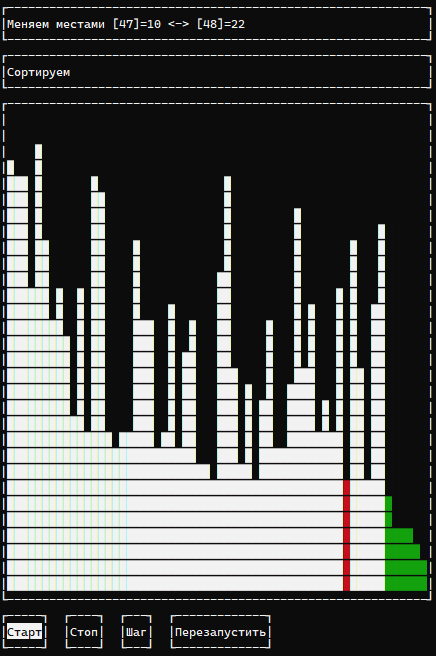
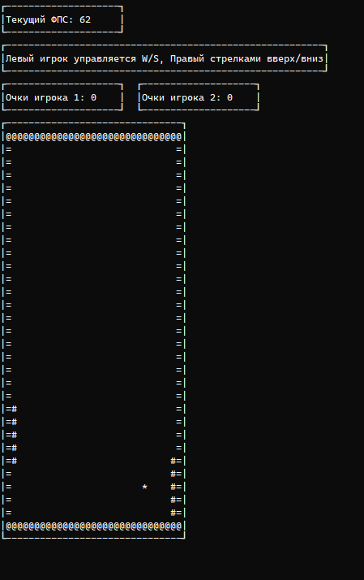
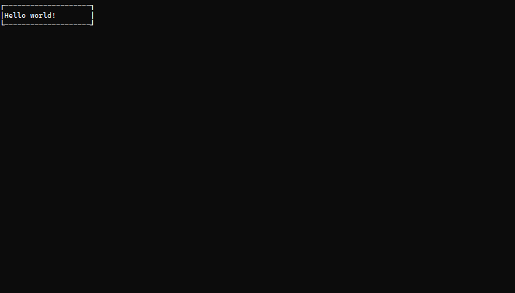
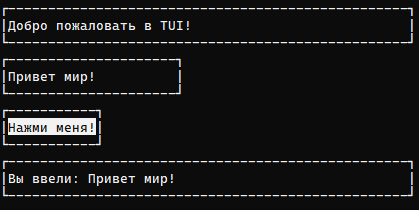

# Shylonamylo.Tui

[](https://www.nuget.org/packages/Shylonamylo.Tui)
[](https://dotnet.microsoft.com/)
[](https://github.com/Shylonamylo/TUI_test_1/blob/HEAD/LICENSE)

Легковесный TUI тулкит, созданный для более быстрого и простого построения интерфейсов для консольных приложений

## Особенности
- **Легковесность**: Проект не имеет внешних зависимостей (zero-dependency).
- **Совместимость**: Полная поддержка **.NET 8** и **.NET 9**.
- **Простота**: Интуитивно понятный API, позволяющий создать первый интерфейс всего в 4 строки кода.
- **Расширяемость**: Плагинная архитектура позволяет создавать свои элементы и рендереры без изменения ядра.

## Демонстрация возможностей

Благодаря `UserCanvas` можно создавать сложные визуализации и даже игры:

| Визуализация пузырьковой сортировки | Классический Понг |
| :---: | :---: |
|  |  |

## Быстрый старт

"Hello world!" в 4 строки:

```csharp
TUI ui = new();
TextBlock textBlock = new(){ Text = "Hello world!" };
ui.AddElement(textBlock);
ui.Run();
```
Результат: 



(Дополнительные примеры вы можете найти, запустив демонстрационный проект TUI_test_1 в репозитории.)

## Установка: 

Через NuGet:

```
dotnet add package Shylonamylo.Tui
```

Из исходников:

```
git clone https://github.com/Shylonamylo/TUI_test_1.git
```

## Базовые элементы

- **TextBlock** - вывод простого текста через свойство `Text`

- **TextBox** - ввод/вывод текста через свойство `Text`

- **Button** - обычная кнопка, нажатие на Enter, после чего вызывается `event OnClick`. Текст поверх - свойство `Label`
- **StackPanel** - элемент для компоновки. Имеет вертикальную и горизонтальную (Horizontal = true) версии.
- **UserCanvas** - холст для рисования чего только захотите, в конструкторе указывается высота и ширина



## Примеры использования

**TextBlock**:

```csharp
TUI ui = new();

TextBlock textBlock = new() { Text = "Текст 1" };

ui.AddElement(textBlock);
ui.Run();
```

**TextBox**:

```csharp
TUI ui = new();

TextBox textBox = new();

ui.AddElement(textBox);
ui.Run();
```

**Button**:

```csharp
TUI ui = new();

Button button = new() { Label = "Click me" };

button.OnClick += () => { /* код */ };

ui.AddElement(button);
ui.Run();
```

**StackPanel**:

```csharp
TUI ui = new();

StackPanel panel = new();

TextBlock textBox1 = new() { Text = "Текст 1" };
TextBlock textBox2 = new() { Text = "Текст 2" };

panel.AddElement(textBox1);
panel.AddElement(textBox2);

ui.AddElement(panel);
ui.Run();
```

**UserCanvas**:

```csharp
TUI ui = new();

UserCanvas userCanvas = new(40,40);

userCanvas.DrawLine(new Vec2I(0,0), new Vec2I(39,39), '#', Style.Default);

ui.AddElement(userCanvas);
ui.Run();
```

## Лицензия

Этот проект распространяется под лицензией MIT. Подробности смотрите в файле [LICENSE](https://github.com/Shylonamylo/TUI_test_1/blob/HEAD/LICENSE).